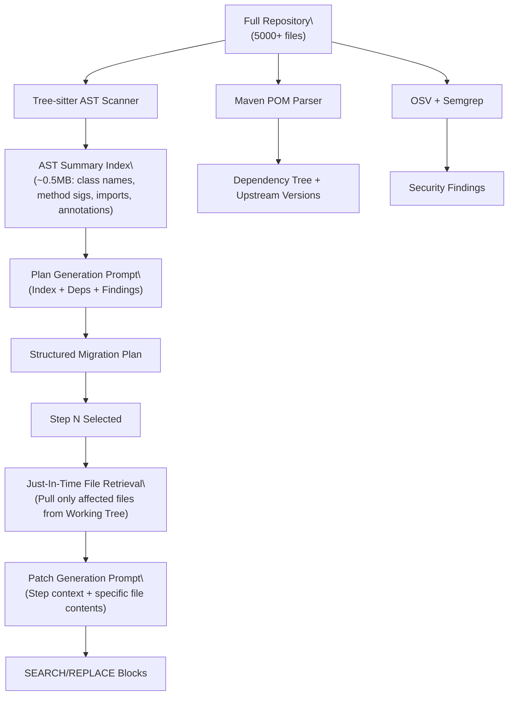

# AI Adapter Architecture, Context Assembly & Abstraction

## 1. Provider-Agnostic LLM Client Design

To prevent vendor lock-in and enable seamless switching between cloud and self-hosted models, StackLift implements a strict abstract interface:

```python
from abc import ABC, abstractmethod

class LLMProvider(ABC):
    @abstractmethod
    async def generate_plan(self, context: dict) -> dict:
        """Generates a structured modernization plan from AST and POM evidence."""
        pass

    @abstractmethod
    async def generate_patch(self, step_context: dict) -> list[dict]:
        """Generates contextual SEARCH/REPLACE blocks for a migration step."""
        pass

    @abstractmethod
    async def revise_patch(self, revision_context: dict) -> list[dict]:
        """Generates revised SEARCH/REPLACE blocks from reviewer feedback."""
        pass

    @abstractmethod
    async def diagnose_failure(self, failure_context: dict) -> list[dict]:
        """Diagnoses compiler/test failure and proposes corrective blocks."""
        pass
```

### Supported Backends:
1. **Anthropic Claude 3.5 Sonnet / Opus**: Exceptional code refactoring and instruction following.
2. **OpenAI GPT-4o**: Fast reasoning and structured JSON output.
3. **Google Gemini 1.5 Pro / Flash**: Large context window for whole-repository context ingestion.
4. **Local / Ollama (DeepSeek Coder / Qwen 2.5 Coder)**: For air-gapped enterprise environments.
5. **Hermetic Mock Adapter (`MockLLMProvider`)**: Deterministic test fixtures for CI without API keys.

---

## 2. The Context Window Problem (Code Retrieval Strategy)

> [!WARNING]
> A typical legacy enterprise Java app can easily have 5,000+ files and millions of lines of code. It is impossible to pass an entire repository into an LLM's context window.

### Context Assembly Pipeline:



### Three-Phase Context Strategy:
1. **Phase 1: Lightweight Index** — During `ANALYZING`, Tree-sitter scans all `.java` files and produces a compact AST Summary Index (class names, method signatures, imports, annotations). This is typically < 1MB even for enormous repositories.
2. **Phase 2: Plan Generation** — The LLM receives the AST Index + POM dependency tree + upstream version matrix + security findings. This gives broad codebase awareness without exhausting context limits.
3. **Phase 3: Just-In-Time File Retrieval** — When the LLM generates a patch for a specific step (e.g., "Migrate `SecurityConfig.java`"), the orchestrator pulls *only* the affected file contents from the current Working Tree and passes them into the Patch Generator prompt.

This ensures deep reasoning without token overflow.

---

## 3. Determinism First, AI for Reasoning

StackLift's Golden Rule: **Never let the language model handle tasks that can be performed deterministically by validated refactoring recipes.**

| Responsibility | Mechanism | Tool / Component |
| :--- | :--- | :--- |
| **Code Structure & AST** | Deterministic | Tree-sitter & `defusedxml` |
| **CVE Identification** | Deterministic | OSV-Scanner |
| **Upstream Version Discovery** | Deterministic | Maven Central / Nexus API |
| **Standard Framework Migrations** | Deterministic | OpenRewrite Recipes |
| **Architecture Interpretation** | AI Guided | LLM Provider |
| **Custom Business Logic Refactoring** | AI Guided | LLM Patch Generator (SEARCH/REPLACE) |
| **Verification & Correctness** | Deterministic | Hardened Docker Container |

---

## 4. Anti-Hallucination & Guardrail Policies

- **Strict Structured Outputs**: Always enforce Pydantic/JSON schema validation on LLM plan output. Reject malformed responses.
- **Grounding in AST Evidence**: Prompts include exact file paths, line numbers, and symbol definitions from Tree-sitter. The LLM is explicitly instructed to not reference files absent from the index.
- **SEARCH Block Validation**: Before applying any SEARCH/REPLACE block, the backend parser verifies the SEARCH text exists verbatim in the target file. If not found, the block is rejected with a diagnostic error.
- **Iterative Retry Bounds**: Cap automated self-healing retries at 3 attempts per step. Cap user-driven revision requests at 5 per step.
- **Prompt Injection Defense**: Source code content is enclosed in fenced delimiters. The system prompt explicitly instructs the model to ignore instructions embedded in source code comments or READMEs.
