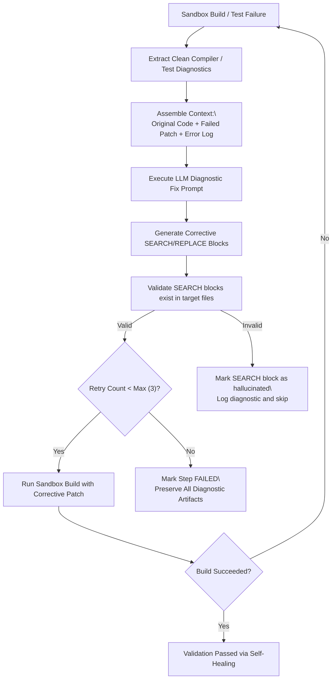

# Failure Diagnostics & Self-Healing Loop

## 1. Automated Diagnostic Loop

When an applied patch causes a build failure (`mvn compile` exit code != 0) or test failure (`mvn test` failures > 0), StackLift initiates a structured diagnostic cycle:

---

## 2. Compiler Error Filtering

Raw Maven output contains hundreds of lines of download status and plugin notices. Before passing to the LLM, the diagnostic extractor cleans the output:

### Extraction Filter Rules:
- Matches lines starting with `[ERROR]` containing file paths: `[ERROR] /workspace/src/main/java/...:[line,col] cannot find symbol`.
- Strips out transfer logs (`Downloaded from central...`).
- Extracts failing assertion stack traces from Surefire reports (`expected: <foo> but was: <bar>`).
- Truncates to the top 50 most relevant error lines to stay within LLM context limits.

---

## 3. Retries & Guardrails

- **Hard Cap**: Self-healing loops are capped at a maximum of 3 automated retries per step.
- **User-Initiated Revisions**: Capped at 5 per step to prevent infinite feedback loops.
- **Audit Preservation**: Every failed attempt, SEARCH/REPLACE block, compiled diff, and compiler log is persisted in `validation_runs` with timestamps and retry sequence numbers.
- **Escalation**: After 3 failed automated retries, the step is marked `FAILED` and the user is shown the full diagnostic trail to investigate manually.
