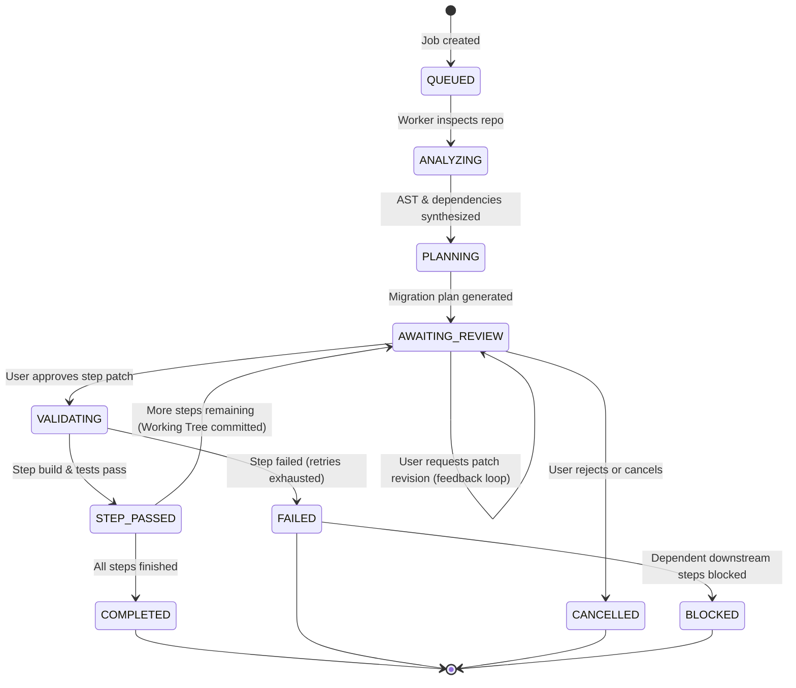
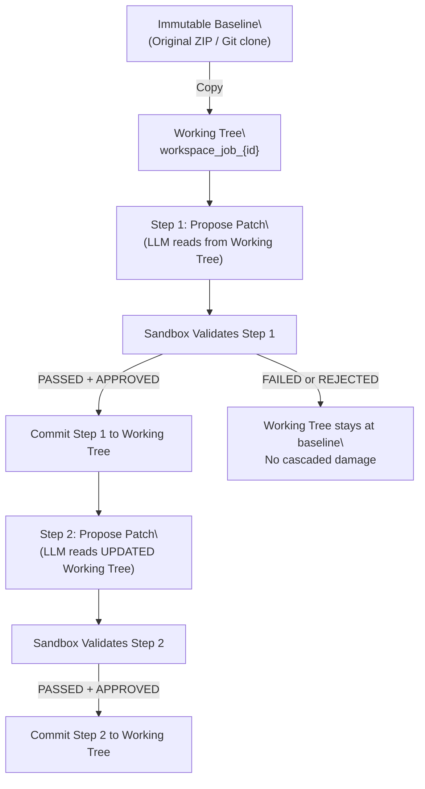

# Job Orchestration, State & Workspace Accumulation

## 1. Job Lifecycle State Machine

To guarantee auditability and eliminate ambiguous states, modernization jobs follow an explicit lifecycle with per-step cycling:

---

## 2. Standardized Status Definitions

| Status Value | Meaning | Transition Trigger |
| :--- | :--- | :--- |
| `QUEUED` | Job created and enqueued; waiting for worker | Initial API job request |
| `ANALYZING` | Worker unpacking files, parsing POM, scanning CVEs, resolving upstream versions | Task picked up by worker |
| `PLANNING` | Static findings synthesized; AI generating structured plan via Context Assembly Pipeline | Analysis completed |
| `AWAITING_REVIEW` | Plan/patch generated; waiting for developer approval, rejection, or revision feedback | Planning or step completion |
| `VALIDATING` | Patch applied in sandbox; running build & tests | User approves patch |
| `STEP_PASSED` | Individual step succeeded; Working Tree updated | Sandbox passes |
| `COMPLETED` | All steps finished; final audit report generated | Last step passes |
| `FAILED` | Unrecoverable error or retries exhausted | Error or max retries |
| `BLOCKED` | Step cannot proceed because a prerequisite step failed | Parent step fails |
| `CANCELLED` | Explicitly aborted by user | User cancels |

---

## 3. State Accumulation & The "Working Tree"

A modernization plan consists of multiple sequential steps. If a user approves Step 1, Step 2 must be generated based on the codebase *after* Step 1 is applied. StackLift maintains a **Patch Stack** via an active Working Tree.

### The Working Tree Lifecycle:

1. **Baseline Ingestion**: The uploaded ZIP/Git clone is mapped to an immutable baseline directory.
2. **Job Branching**: When a `ModernizationJob` begins, a temporary `workspace_job_{id}` copy of the baseline is created.
3. **Step Proposal**: The LLM/OpenRewrite reads from the *current* `workspace_job_{id}` to propose a patch.
4. **Step Validation**: The patch is applied to a disposable sandbox clone of the Working Tree.
5. **Step Commit (Success)**: If the sandbox build passes AND the user approved, the patch is physically applied and "committed" to `workspace_job_{id}`.
6. **Next Step Generation**: The AI analyzes the newly updated `workspace_job_{id}` to generate the patch for Step 2.
7. **Rollback (Failure/Rejection)**: If a patch is rejected or fails, `workspace_job_{id}` remains untouched, preventing cascaded failures.

---

## 4. Iterative Patch Refinement (Human-in-the-Loop)

When a user inspects a patch diff and finds it 95% correct but needs minor fixes:

1. User clicks **"Request Revision"** and types feedback: *"The patch looks good, but rename `paymentSvc` to `paymentGateway`."*
2. The system sets `patch.approval_status = REVISION_REQUESTED` and stores the feedback text.
3. The AI is re-invoked with:
   - The current Working Tree file contents.
   - The previous patch attempt.
   - The user's revision feedback.
4. A new `Patch` record is created with `patch_version = 2`.
5. The user reviews the revised diff and can approve, reject, or request another revision.
6. **Hard cap**: Maximum 5 revision iterations per step to prevent infinite loops.
7. **Optimistic Concurrency Control (OCC)**: Review mutations (approval, rejection, revision requests) require submitting the current `version_id`. If `version_id` does not match the database state (e.g. concurrent submission or double click), the API returns HTTP 409 Conflict to protect the patch stack.

---

## 5. Error Handling & Diagnostic Preservation

> [!IMPORTANT]
> When a job fails, StackLift **NEVER** silently discards state. It preserves the exact diagnostics.

### Preserved Artifacts on Failure:
1. **Raw Exit Codes**: Compiler, build tool, and container exit codes.
2. **Filtered Diagnostics**: Cleaned compiler error messages and stack traces.
3. **Patch Provenance**: The exact Search/Replace blocks and unified diff that caused the failure.
4. **Environment Context**: JDK version, container image tag, and resource limits.

### Handling Skipped or Unsupported Steps:
- **Missing Test Suites**: `test_status: SKIPPED (No tests found)` with truth warning.
- **Integration Tests Skipped**: `integration_tests_skipped: true` with reason: "No sidecar DB configured."
- **Unsupported Syntax**: OpenRewrite leaves code untouched; flagged for manual review.

### 5.1. LLM Token Circuit Breakers
To prevent infinite loops of failing AI generations or recursive patch self-healing loops draining token budgets:
- **Max Steps Circuit Breaker**: Hard cap of 20 modernization steps per job.
- **Time/Duration Breaker**: Hard limit of 60 minutes of AI inference/sandbox validation time per job.
- **Self-Healing Cap**: Maximum of 3 patch retries per failed step. If it still fails, the step is marked `FAILED` and downstream dependencies are marked `BLOCKED`.

---

## 6. Worker Queue Design (Redis + ARQ / Celery)

### 6.1. Queue Segregation
1. `fast_queue`: Lightweight tasks (ZIP extraction, AST parsing, OSV-Scanner checks, Plan JSON generation, upstream version resolution). Max concurrency: 8.
2. `sandbox_queue`: Heavy tasks (Docker sandbox container launch, Maven compilations, Surefire test runs). Max concurrency: 2 (CPU/memory bound).

### 6.2. Heartbeats and Job Recovery
- Every active worker publishes a heartbeat every 10 seconds.
- If a worker dies mid-job, the orchestrator detects the expired lease after 60 seconds and marks the job as `FAILED` with diagnostic reason `WORKER_TIMEOUT_OR_TERMINATED`.
