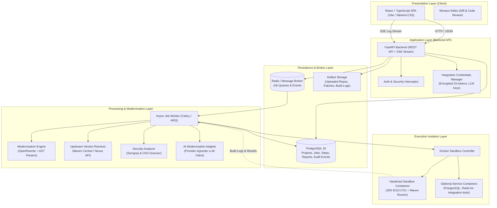

# System Architecture & Topology

## 1. High-Level Architectural Topology

StackLift is built around a decoupled, event-driven architecture designed to keep user-facing API interactions responsive while long-running code analysis and containerized build tasks run asynchronously in isolated workers.

---

## 2. Technology Stack Matrix

| Layer | Recommended Choice | Rationale |
| :--- | :--- | :--- |
| **Frontend** | React 18/19, TypeScript, Vite, Tailwind CSS | Fast build times, strong typing, clean component ecosystem. |
| **Code Review UI** | Monaco Editor | The industry gold standard for diffing, syntax highlighting, and code review. |
| **Backend API** | FastAPI, Pydantic v2, Python 3.11+ | High performance, native async support, rich data validation, fast prototyping. |
| **Database** | PostgreSQL 16, SQLAlchemy 2.0, Alembic | ACID compliance, JSONB support for plans & logs, robust indexing. |
| **Job Queue** | Redis + ARQ or Celery | Lightweight, reliable asynchronous task queue with retry primitives. |
| **AI Integration** | Provider-independent adapter (Claude, GPT, Gemini, Ollama) | Prevents vendor lock-in; supports mock adapters for hermetic local testing. |
| **Java Refactoring** | OpenRewrite & Tree-sitter | Deterministic recipe execution for Java ecosystem refactors. |
| **Version Resolution** | Maven Central Search API / Nexus REST | Required to identify latest stable versions and build upgrade targets. |
| **Security Scanning**| OSV-Scanner, Semgrep | Fast, open-source vulnerability and code pattern scanners. |
| **Sandbox Execution**| Docker API with restricted profiles | Hermetic isolation, reproducible builds, host protection. |
| **Credential Mgmt** | Encrypted DB columns (Fernet / KMS) | Secure storage of Git tokens and API keys, never exposed in containers. |

---

## 3. Communication Patterns

1. **Synchronous REST Calls**: Fast metadata operations (listing projects, reading job summaries, approving patches).
2. **Asynchronous Job Queues**: Heavy jobs (ZIP extraction, AST parsing, OpenRewrite execution, Docker builds) pushed to Redis broker.
3. **Real-Time Streaming**: Server-Sent Events (SSE) stream terminal logs and step progress from worker -> backend -> browser in real-time.
