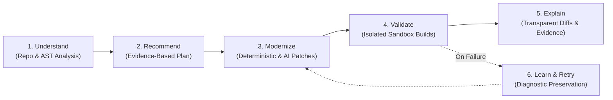

# Vision, Mission & Core Philosophy

## 1. Executive Summary

**StackLift** is an AI-powered legacy software modernization platform.
It enables engineering teams to upgrade, refactor, and migrate existing application stacks safely, efficiently, and transparently through AI-assisted analysis, deterministic automation, and evidence-based validation.

- **Tagline**: *Lift Legacy. Build Forward.*
- **Mission**: Help engineering teams modernize legacy software safely, efficiently, and transparently through AI-assisted analysis, automated migration, and evidence-based validation.
- **Vision**: Make software modernization a repeatable, measurable engineering process rather than a costly, manual, high-risk undertaking.

---

## 2. Core Positioning & Philosophical Anchor

> [!IMPORTANT]
> **StackLift is NOT an AI code-rewriting chat tool.**
> It is an **engineering platform** that analyzes legacy applications, formulates structured migration roadmaps, applies deterministic and controlled changes, and strictly verifies the outcome in isolated sandboxes.

---

## 3. The Modernization Challenge

Legacy applications power critical enterprise operations, yet they routinely run on:
- Outdated language runtimes (e.g., Java 8 / 11).
- End-of-life frameworks (e.g., Spring Boot 1.x / 2.x).
- Vulnerable or deprecated dependencies with known CVEs.
- Monolithic architectures with lost tribal knowledge and incomplete documentation.

### Core Bottlenecks:
1. **High Cognitive Load**: Developers spend weeks understanding unfamiliar architectures and deciphering transitive dependency trees.
2. **Hidden Incompatibilities**: Upgrading one library cascades into breaking changes across the entire build classpath.
3. **Unstructured Migration Planning**: Tasks are fragmented across tickets, wikis, and informal notes without deterministic dependency ordering.
4. **Fear of Regressions**: Without sandboxed verification and comprehensive test regression checks, teams delay upgrades until security compliance forces urgent action.
5. **AI Hallucinations / Regressions**: Unchecked LLMs generate plausible-looking code that fails compilation or introduces subtle runtime bugs.

---

## 4. The StackLift Solution: Six Pillars

1. **Understand**: Deeply analyze the repository to discover technologies, AST structures, Maven configurations, transitive dependencies, and technical debt.
2. **Recommend**: Produce a prioritized, ordered modernization plan supported by repository evidence.
3. **Modernize**: Generate minimal, precise code and dependency patches using a blend of deterministic migration recipes (e.g., OpenRewrite) and guided LLM reasoning.
4. **Validate**: Execute compilations, test suites, and security scans in isolated sandbox environments.
5. **Explain**: Provide engineers with exact diffs, rationale, evidence trails, and explicit statements of what was validated and what remains unverified.
6. **Learn from Failures**: Capture build outputs, stack traces, and compiler errors to diagnose root causes and enable safe, iterative retries.

---

## 5. Target Personas

### Persona 1: Software Developers & Maintenance Engineers (Primary Target)
- **Profile**: Maintains existing applications, addresses vulnerability tickets, updates outdated libraries, and fixes deprecated API usages.
- **Pain Points**: Repetitive migration boilerplate, cryptic build failures after version bumps, unfamiliar codebase legacy patterns.
- **Value Realization**: Automated dependency upgrades, verified compilation patches, pinpoint compiler error diagnostics.

### Persona 2: Software Architects & Technical Leads
- **Profile**: Evaluates platform health, assesses technical debt, plans framework upgrades, ensures compliance.
- **Pain Points**: Lack of visibility into dependency vulnerability risks and architecture bottlenecks across multiple repositories.
- **Value Realization**: Evidence-based modernization roadmaps, risk categorization, predictable upgrade sequencing.

### Persona 3: Platform Engineering & DevOps Teams
- **Profile**: Manages CI/CD pipelines, runtime base images, security policies, and standard toolchains.
- **Pain Points**: Inconsistent local build environments, build failures propagating to central CI pipelines.
- **Value Realization**: Isolated reproducible sandboxes, standardized build checks, automated CVE scans before merging.

### Persona 4: Engineering Managers & Modernization Executives
- **Profile**: Allocates budgets, balances feature velocity with technical debt reduction, monitors compliance.
- **Pain Points**: Difficulty quantifying migration progress and estimating refactoring timelines.
- **Value Realization**: High-level modernization reports, verified success metrics, reduced delivery risk.
