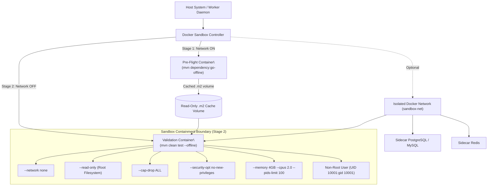

# Container Isolation & Sandbox Architecture

## 1. Hardened Docker Sandbox Architecture



---

## 2. The Three-Stage Execution Model

### Stage 1: Pre-Flight Dependency Download (Network ENABLED)
- **Goal**: Download all required Maven dependencies into a local `.m2` volume.
- **Network**: ENABLED (fetch from Maven Central, private Nexus/Artifactory using encrypted credentials from the Credentials Manager).
- **Execution Command**:
  ```bash
  mvn dependency:go-offline dependency:resolve-plugins -B -fn
  ```
- **Security Control**: `go-offline` and `resolve-plugins` resolve the POM model and download artifacts but **do not execute any code, compilers, plugins, or unit tests**. It is a purely declarative resolution phase.
- **Credential Handling**: If the project's `pom.xml` declares private `<repositories>`, the worker injects a temporary `settings.xml` containing decrypted registry tokens. This `settings.xml` is **NOT** carried forward to Stage 2.

### Stage 2: Sandboxed Build & Validation (Network DISABLED)
- **Goal**: Apply the patch, compile the code, and run tests.
- **Network**: DISABLED (`--network none`) unless sidecar services are required (see Stage 3).
- **Dynamic Image & Runner Selection**:
  - The image is selected dynamically based on `detected_build_system` and `language_and_frameworks.java` (e.g. `stacklift/sandbox-java8:latest`, `sandbox-java11:latest`, `sandbox-java17:latest`, `sandbox-java21:latest`).
  - The build script prefers `./mvnw` if present in repository root; otherwise falls back to system `mvn`.
- **Execution Command**:
  ```bash
  # Dynamically resolved: ${SANDBOX_IMAGE} and ${MVN_BIN} (./mvnw or mvn)
  docker run --rm \
    --name "sandbox-val-${RUN_ID}" \
    --network none \
    --read-only \
    --user 10001:10001 \
    --cap-drop ALL \
    --security-opt no-new-privileges:true \
    --memory 4g \
    --cpus 2.0 \
    --pids-limit 100 \
    --tmpfs /workspace:rw,noexec,nosuid,size=2g \
    --tmpfs /tmp:rw,noexec,nosuid,size=512m \
    -v ${JOB_M2_CACHE}:/home/builduser/.m2/repository:ro \
    ${SANDBOX_IMAGE} \
    ${MVN_BIN} clean test --offline
  ```
- **Security Control**: Network access is completely severed. Any malicious test or plugin attempting to exfiltrate data fails immediately.

### Stage 3: Optional Sidecar Service Containers (Integration Tests)

> [!WARNING]
> **The Integration Test Problem**:
> Legacy Java applications frequently mix unit tests with integration tests. If `mvn test` tries to connect to a database at `localhost:3306`, the test will fail because the sandbox is empty and networkless.

#### Handling Strategy:
1. **Default Behavior**: Skip integration tests using Maven profile flags:
   ```bash
   mvn clean test -DskipITs -Dspring.profiles.active=test
   ```
   The report explicitly states: *"Integration tests were skipped due to external service dependencies."*

2. **Opt-In Sidecar Mode**: If the user explicitly enables integration test support (via project configuration), StackLift:
   - Creates an isolated Docker network (`sandbox-net-${RUN_ID}`).
   - Spins up ephemeral sidecar service containers (e.g., `postgres:16-alpine`, `redis:7-alpine`) connected to that network.
   - Connects the sandbox build container to the *same isolated network* — but this network has **no route to the public internet** (internal-only).
   - Passes the sidecar hostnames via environment variables (e.g., `SPRING_DATASOURCE_URL=jdbc:postgresql://sidecar-db:5432/testdb`).
   - After the run completes, all containers and the network are destroyed.

3. **Auto-Detection Heuristic**: During analysis, StackLift inspects:
   - `src/test/resources/application-test.yml` or `application-test.properties` for `spring.datasource.url` declarations.
   - Maven Failsafe plugin configuration (presence of `maven-failsafe-plugin` indicates integration tests).
   - If detected, the UI warns: *"This project appears to have integration tests requiring external services. Enable sidecar containers or skip ITs."*

---

## 3. Hermetic Maven Cache Strategy

Because Stage 2 executes with `--network none` and `--offline`:
- Common JDK plugins, Spring Boot starter POMs, and test frameworks are pre-baked into the image or mounted from a shared read-only host volume.
- The `.m2` repository downloaded during Stage 1 is mounted as **read-only** (`:ro`), ensuring the build cannot taint the cache for subsequent runs.
- Any attempts by malicious build scripts to download unvetted remote jars fail instantly.

---

## 4. Container Cleanup & Garbage Collection

- All sandbox containers are created with `--rm` (auto-remove on exit).
- Working Tree workspace directories for completed or cancelled jobs are scheduled for deletion after 30 days.
- Sidecar service containers and isolated networks are destroyed within 30 seconds of build completion, regardless of outcome.
- The Docker socket is NOT mounted inside any container. The Sandbox Controller operates from the host worker daemon exclusively.
